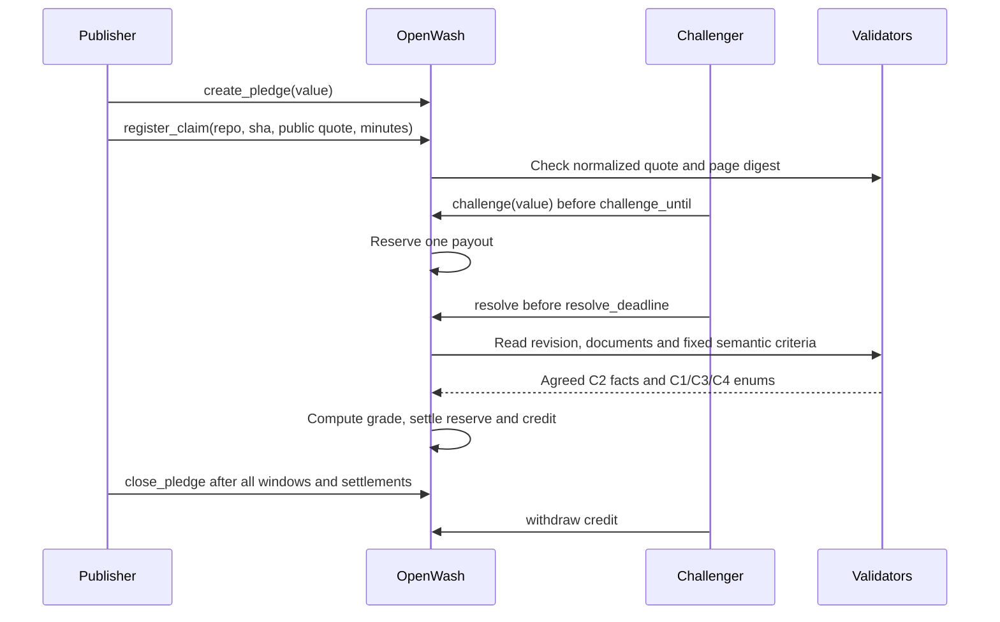

# Architecture

## Contract boundary

`contracts/open_wash.py` is a single contract on the pinned Python runner. `Pledge` stores the available and reserved GEN, publisher, coverage and latest claim deadline. `Claim` binds a statement to a model revision and the SHA-256 of the observed quote page. `Challenge` holds a stake, a three-day resolution deadline, criteria and a source trace from its own resolution. A permissionless `grade_claim` can refresh a claim’s documentary assessment without moving funds or changing its status. A debunked claim keeps its settled grade.

The constructor accepts a minimum challenge period of 10–129600 minutes. A typical production floor would be 10080 minutes. Each claim starts at registration and its deadline must fall strictly before pledge expiry. A pledge covers 7–365 days and up to 50 claims. Filing reserves one payout, requires a stake of at least one tenth of that payout and permits up to five open challenges per challenger. A single claim has at most one open challenge. Filing and reserving do not require external reads.

## States and boundaries

At `now == challenge_until` filing is already closed. A successful challenge permanently marks the claim DEBUNKED. Without an open challenge, expiry projects CLOSED through the single-record, list, window and status views. A previously filed challenge may still resolve after the claim window. Expiry is available at the resolution deadline, when resolve is refused. The latest registered deadline locks the pledge, including after a successful settlement. Reserved payouts independently block close. Pledge coverage limits registration. It does not force an idle bond to remain locked for seven days.

## Evidence and agreement

Registration strips markup and script elements, decodes entities, applies Unicode NFKC and lowercase, and compacts whitespace. Validators repeat the page read and agree on the source URL, status and normalized quote match. The stored digest identifies the leader’s bytes, so unrelated dynamic HTML does not require identical page digests. A Web GET may follow redirects. The quote record retains the available final URL or the request URL when the runner omits the final URL.

Resolution starts with the pinned `/api/models/{repo}/revision/{sha}`. The response must be HTTP 200, valid JSON for the same repository and SHA, and match the requested URL if the runner exposes the final URL. Unreadable and mismatched pins refund the stake as EVIDENCE_NOT_FOUND. The contract never substitutes the current model endpoint. It normalizes the gate and checks weight suffixes in `siblings[].rfilename`. Unknown gate values fail closed. The semantic model never controls C2.

For the card and license, the contract tries raw and retries a 401 through resolve at the same SHA. It keeps metadata license, license link, extra gate prompt, data references and license tags. A unique GitHub repository on a line identifying training can supply SPDX corroboration. The repository metadata is current at resolution. Each read records its request, available final URL, HTTP status and digest of the admitted bytes. A transport failure has status zero. A source over 3 MB is discarded. The contract does not use the dataset API. Model-card and license excerpts are each limited to 8000 characters.

The fixed English instructions and JSON schema are embedded in the contract. Sources follow in a JSON-encoded untrusted section. Validators rerun the reads and prompt. Agreement covers revision, readability, gate, weight presence, C2 and C1/C3/C4 enums. The stored raw-response fingerprints describe the leader’s reads. They are useful for auditing and do not require independent API responses to be byte-identical. Malformed semantic enums abort resolution, preserving the open challenge. Free-text reasons and model-proposed final grades cannot change payouts. See the [non-determinism documentation](https://docs.genlayer.com/developers/intelligent-contracts/features/non-determinism).

## Accounting in wei

| Resolution | Available bond | Reserve | Credit |
|---|---|---|---|
| UPHELD | No return from reserve | Release payout | Challenger gets entire payout plus stake |
| REJECTED | Restore payout and add stake | Release payout | None |
| EVIDENCE_NOT_FOUND or EXPIRED | Restore payout | Release payout | Challenger gets stake |
| Close | Set available bond to zero and close pledge | Must already be zero | Publisher gets remaining bond |
| Withdraw | No change | No change | Clear credit and total first, then emit transfer |

After every accepted operation, deposits less emitted transfers equal active bonds plus reserves, open stakes and total credits. A failed payable on Studionet can credit value outside the contract’s successful accounting path. Every CLI write checks its preview. A preview and signature are separate operations, so concurrent transactions can invalidate the check. The two expected-refusal commands use zero value and validate the exact refusal against the preview.

## Threat model and limits

- A publisher controls its statement. Inclusion verifies the quoted words, not authorship or endorsement by the model developer. Demo pages identify the speaker.
- The HF commit pins weights and documentation. Gates can change at repository level. A mutable claim page is fingerprinted at registration. GitHub corroboration is unpinned.
- A listing cannot authenticate the weights or reproduce a training run. C3 and C4 rely on available documentation. A short or unavailable card can leave the judge with incomplete evidence.
- Source text can attempt prompt injection. Structural encoding, a fixed rubric and enum validation constrain the output. They cannot guarantee semantic correctness against misleading evidence.
- Bond reservations are first-come, first-served. Multiple claims share available funds. One open case blocks replay on that claim. An upheld claim cannot earn a second payout. Identity caps apply per address. Aggregate list and standing views scan the register and can become expensive on large deployments.
- The public UI reads without a wallet and projects elapsed windows between refreshes. The on-chain preview remains authoritative. Only the operator’s encrypted CLI keystore signs the prepared command.
- Non-agreement, temporary source failures and rate limits are possible. An open challenge can expire after three days. A receipt timeout is handled by polling the original hash.
- Not legal advice. The rubric is narrower than a complete OSAID audit or determination under the AI Act.
